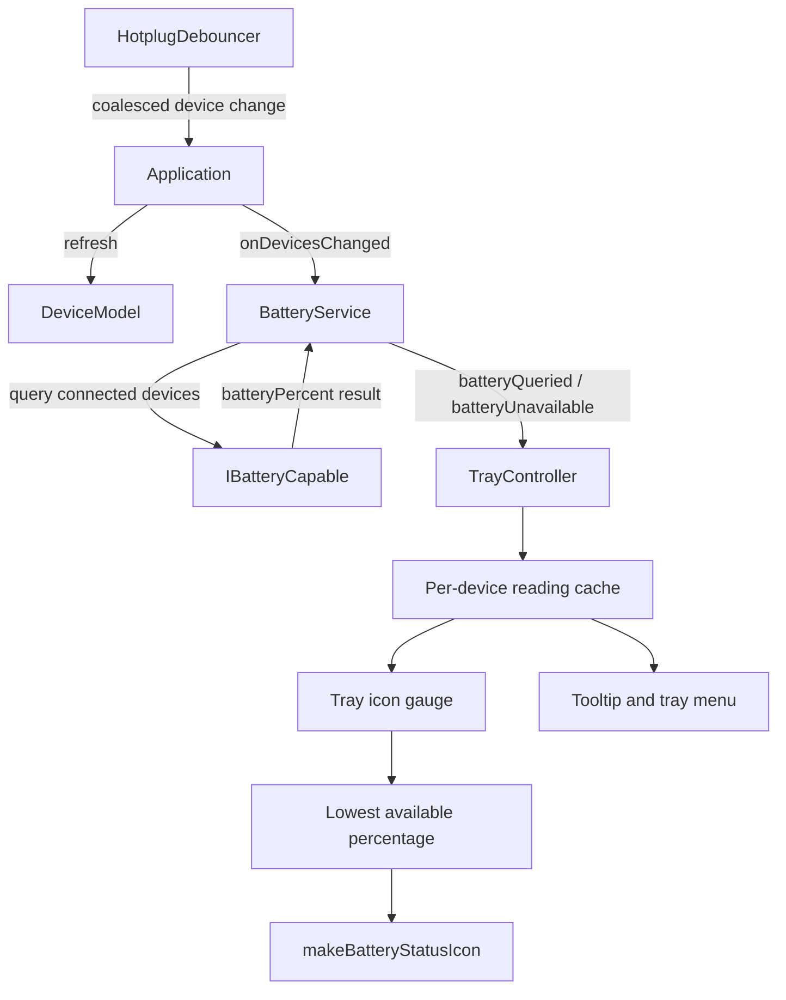

# Mouse Battery Tray Indicator

## Purpose

The application tray now keeps a visible battery gauge for connected devices
that implement `IBatteryCapable`. The gauge complements the per-device battery
percentage shown in the device UI.

## Data Flow

`BatteryService` schedules an initial query when automatic polling is enabled
and retains its recurring 15-second poll. On a coalesced arrival or removal,
`Application` refreshes the device model and asks the service to reconcile the
connected set. Disconnected readings are cleared even when automatic polling is
disabled; connected devices are queried only when polling is enabled.

`TrayController` subscribes to the service signals. It keeps one latest reading
per device, sorts device names in the tooltip and menu, and draws a multi-size
charge gauge over the existing application icon. The icon uses the lowest
available percentage so that one nearly empty device remains visible. Values
below 20 percent receive a low-battery label and a warning on the first
transition below that threshold. When no readings remain, the tray returns to
the original application icon and shows that battery data is unavailable.

Each synchronous query logs its elapsed duration and outcome. This separates a
slow device lookup or HID open from an unavailable report and the device
protocol's own wait.

## Tests

- `test_battery_service.cpp` covers the first reading without waiting for the
  recurring timer, cancellation when polling is disabled, and stale-state
  removal after disconnect.
- `test_tray_battery.cpp` covers per-device updates, clamping, low-battery
  presentation, service signal wiring, disconnect cleanup, and different icon
  rasters at 16, 22, 32, and 64 pixels.
- The tests use mock devices and do not require a live HID device or Plasma
  tray host.

## Verification Limits

The code and tests verify tray state and generated icon pixels. They do not
prove that a specific Plasma panel renders the icon or tooltip. In a sandbox
without access to the user's session D-Bus and `/dev/hidraw*`, physical tray
rendering and live mouse readings must be checked in a normal desktop session.

See [Troubleshooting](../wiki/Troubleshooting.md#mouse-battery-percentage-is-missing-from-the-tray)
for runtime checks.
